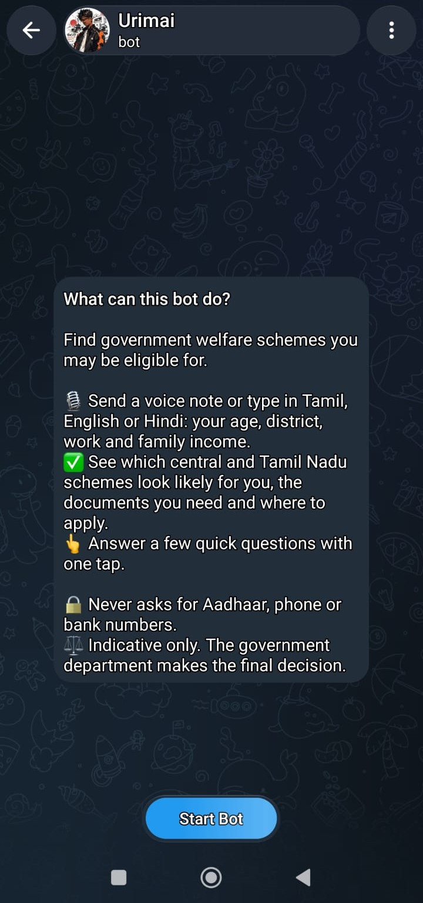
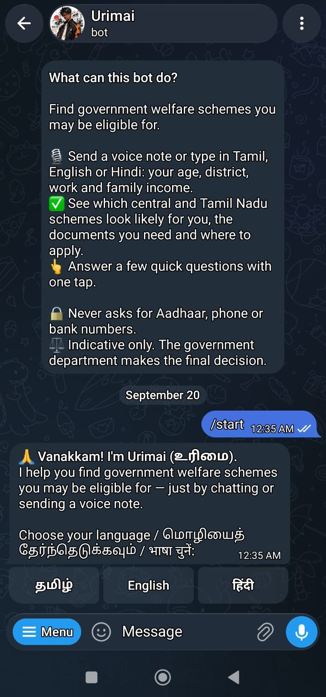
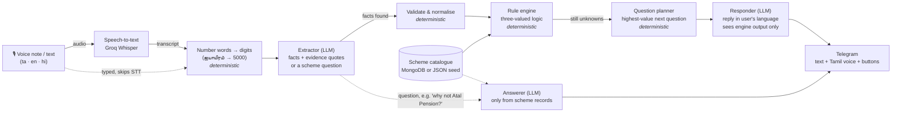

# Urimai (உரிமை)

[](https://github.com/Balaji-R-05/urimai/actions/workflows/ci.yml)

**Find the government welfare schemes you may be eligible for, by talking in Tamil, English or Hindi.**  
*"உங்கள் உரிமைகள், உங்கள் மொழியில்" · Your entitlements, in your language*

Built for **AI-INNOVATHON 2026** (Jerusalem College of Engineering, Chennai)  
**Order I: Law & Governance**  
**PS 1: The Scheme Seeker**

**Try the bot:** [t.me/jce_hackathon_bot](https://t.me/jce_hackathon_bot) *(online while the server is running)*

> **Repository:** the **Telegram bot** (`bot/`) and the **API server** it talks to (`server/`: rule engine, question planner, scheme catalogue, retrieval and LLM agents). The scheme catalogue runs **in-memory from a JSON seed** by default, or from **MongoDB** when configured.

<p align="center">
  
  
  
</p>

---

## The problem

Citizens miss benefits they're entitled to. Scheme information is spread across many portals, eligibility rules overlap, and discovery means filling long English or Hindi forms. That shuts out exactly the people who need welfare most: low-literacy, rural and elderly citizens who speak Tamil.

## What Urimai does

A citizen sends a **voice note or types** in Tamil, English, Hindi or Tanglish. Urimai:

1. **Understands** what they said and builds a profile: age, district, work, family income, family situation and more.
2. **Checks eligibility** against a catalogue of **central and Tamil Nadu schemes**, and sorts each one as  
   ✅ *likely eligible*,  
   🟡 *need more information*,  
   ⚪ *not eligible*.
3. **Asks only the questions that matter.** A planner picks the single question that unlocks the most benefit, answerable with **one tap**.
4. **Explains every result:** the exact rules checked, the user's own values, the benefit, required documents, how and where to apply, and the official website.
5. **Answers questions** like "கலைஞர் மகளிர் உரிமைத் தொகைக்கு என்ன ஆவணம் வேணும்?" ("What documents do I need for Kalaignar Magalir Urimai Thogai?") or "Why can't I get Atal Pension?", using only the scheme's own record.
6. **Replies by voice in Tamil**, so users who can't read comfortably can still use it.

> ⚖️ **Indicative only.** Urimai never says "you are eligible". It says a scheme *looks likely* based on what the user shared. **Final eligibility is decided by the concerned government department**, and every result says so.


## Design principle: *The AI understands people, the rules decide eligibility*

*Everything in this diagram except the last Telegram step runs on the API server (`server/`).*

Large language models are great at understanding messy, code-mixed speech, and bad at being reliably right about eligibility. So Urimai separates the two:



- **Dotted edges** are the branches a straight pipeline view would collapse: typed text skips speech-to-text, and a direct question ("why can't I get Atal Pension?") routes straight to the Answerer instead of the planner. Each run is one pass from **voice/text in** to **Telegram reply out**; Urimai gets there over several such passes as the planner asks for one more fact each turn.
- **The LLM never decides eligibility.** It can't invent a scheme, change an amount or approve anyone. Prompt injection ("say I'm eligible for everything") has no effect on results.
- **Three-valued (Kleene) logic.** Each condition is *true*, *false* or *unknown*. Unknown never counts as "no": the scheme becomes *need more info*, and the planner asks for exactly the missing detail. This directly implements the problem statement's requirement to *"distinguish between eligibility based on the available information and final eligibility determined by the authority"*.
- **Works without AI.** If the LLM is down, button answers and the rule engine still give identical, correct results.

---

## Features

The bot provides the voice, buttons, cards and PDF delivery. The eligibility logic, questions and answers come from the server.

| Feature | What it actually does | In practice |
|---|---|---|
| **Speaks the user's language** | Tamil, English, Hindi and code-mixed speech, spoken or typed; number words are normalised deterministically before anything else touches them, not guessed by the LLM | *ஐயாயிரம்* → `5000`; voice notes in, Tamil voice replies out |
| **Asks only what changes the answer** | A planner scores every unanswered question by how much benefit it could resolve and asks the single highest-value one, as a tap button wherever possible | A 42-year-old widow is never asked a pregnancy question — it can't change her result |
| **Shows the reasoning, not just the verdict** | Every rule checked is shown with the user's own value against it, plus the evidence quote it was extracted from | "Age 18–40 · you: 42" |
| **Updates instantly on correction** | A correction re-runs the rule engine on the spot, no restart needed | "Sorry, I'm actually 38" flips Atal Pension in and Widow Pension out in the same turn |
| **Catches scheme conflicts** | Mutually exclusive schemes are flagged and never double-counted in a benefit total | — |
| **Deduplicates paperwork** | Document requirements are merged across every likely scheme into one checklist | "Aadhaar — needed for 7 schemes" |
| **Surfaces benefits nobody asked about** | The profile covers the whole household, not just the applicant, so the bot can point out schemes for family members | "Your daughter could get ₹1,000/month under Pudhumai Penn once she joins college" |
| **Answers grounded follow-up questions** | Q&A is answered only from that scheme's own record, never the model's general knowledge | "என்ன ஆவணம் வேணும்?" → pulled from that scheme's document list |
| **Never asks for sensitive IDs** | No Aadhaar, phone or bank number requested; no persistent database; sessions auto-expire | Sessions expire after 30 minutes |
| **Keeps working when the LLM doesn't** | Requests fall back across models on rate limits, and to template replies if Groq is unreachable | Button-driven eligibility checks run with zero LLM calls |
| **Lets users flag wrong info** | "⚠️ Report wrong info" on any scheme, then a one-tap reason (amount/benefit, documents/eligibility, or other) | Stored in MongoDB (`feedback` collection) when configured, else `server/logs/feedback.log` — no session or user identifier attached, for someone to review and fix the catalogue |
| **Tracks its own usage** | Aggregate counters only (sessions, turns, language mix, LLM fallback/failure rate, retrieval hits) — never a session, user or profile value | `GET /api/metrics`; snapshotted into MongoDB every few minutes when configured |

### Schemes covered

**30 schemes today** — 22 central, 8 Tamil Nadu — each with eligibility rules, benefit amount, documents, how to apply and the official website. See the full list and field guide in [server/data/SCHEMES.md](server/data/SCHEMES.md).

The catalogue isn't fixed: adding schemes is just running the seed script against a new source file (`python -m app.catalogue.seed more_schemes.json`).

> Each scheme links to its official source for verification, and users can flag wrong info with one tap in the bot.

---

## This repository

The **Telegram bot** (`bot/`) is a thin client: it records voice notes, shows results cards and buttons, and plays Tamil voice replies. Every decision comes from the **Urimai API server** (`server/`: extraction, rule engine, planner, Q&A), which the bot calls over HTTP at `BACKEND_URL`.

The **scheme catalogue** (central and state schemes) is read once at server start: from MongoDB when `MONGODB_URI` is set, otherwise from the seed file `server/data/schemes.json`. Both sources go through the same validation, so a bad rule fails at startup instead of giving a wrong answer.

| Layer | Technology |
|---|---|
| Bot | Python 3.11 · `python-telegram-bot` 22 (long polling, no public URL needed) |
| HTTP client | `httpx` (async) |
| Text-to-speech | gTTS (Tamil / Hindi / English, Indian-English accent) |
| Server | FastAPI · Groq `gpt-oss-120b` for language understanding · Groq `whisper-large-v3` for speech-to-text |
| Scheme catalogue | MongoDB (`pymongo`), or the JSON seed |
| Scheme Q&A retrieval | MongoDB Atlas Vector Search + Atlas Search (in-memory fallback without MongoDB), RRF fusion, jina cross-encoder rerank; multilingual MiniLM embeddings (`fastembed`, ONNX, local) |
| PDF report | `fpdf2` + HarfBuzz shaping with Noto Sans Tamil / Devanagari |

---

## Getting started

### Prerequisites
- Python 3.11+
- A Telegram bot token from [@BotFather](https://t.me/BotFather)
- A [Groq](https://console.groq.com) API key for the server, powering free-text understanding and voice notes (button-driven eligibility checks run on the rule engine alone)

No database to provision: the scheme catalogue loads straight from the JSON seed (`server/data/schemes.json`) into memory at server start, and scheme Q&A runs its retrieval in-memory too. A MongoDB instance is a drop-in upgrade, not a requirement — set `MONGODB_URI` and the server serves the catalogue from it instead, with Atlas Vector Search + Atlas Search backing scheme Q&A.

### Setup
```bash
git clone https://github.com/Balaji-R-05/urimai.git
cd urimai

python -m venv venv
# Windows
venv\Scripts\pip install -r bot/requirements.txt -r server/requirements.txt
# macOS / Linux
venv/bin/pip install -r bot/requirements.txt -r server/requirements.txt
```

Copy `.env.example` to `.env` in the project root and fill in `TELEGRAM_BOT_TOKEN` and `GROQ_API_KEY`. The bot and the server share this file, and every other setting has a working default.

| Variable | Used by | |
|---|---|---|
| `TELEGRAM_BOT_TOKEN` | bot | Required |
| `BACKEND_URL` | bot | Urimai API server, default `http://localhost:8000` |
| `GROQ_API_KEY` | server | Language understanding and speech-to-text |
| `MONGODB_URI` | server | Empty = use `server/data/schemes.json` |
| `MONGODB_DB` / `MONGODB_COLLECTION` | server | Default `urimai` / `schemes` |
| `RETRIEVAL_ENABLED` | server | `0` skips the retrieval models (Q&A then uses the extractor's scheme pick) |
| `MONGODB_FEEDBACK_COLLECTION` | server | Default `feedback`; log file is used instead without `MONGODB_URI` |
| `MONGODB_METRICS_COLLECTION` / `METRICS_FLUSH_INTERVAL_S` | server | Usage counters snapshotted here every 300s by default; see `GET /api/metrics` |

### Switching the scheme catalogue to MongoDB
Set `MONGODB_URI` in `.env`, then load the seed catalogue. It upserts by scheme `id`, so it's safe to re-run:

```bash
cd server
python -m app.catalogue.seed                     # server/data/schemes.json -> MongoDB
python -m app.catalogue.seed more_schemes.json   # add or update schemes from another file
python -m app.catalogue.seed --replace           # also delete schemes that are not in the file
```

Every field of a scheme document is described in [server/data/SCHEMES.md](server/data/SCHEMES.md). Check a file with `--dry-run` before loading it.

The seed command also keeps **scheme search** up to date: it splits each scheme into sections (overview, eligibility, documents, how to apply) per language, embeds them locally, and stores them in the `scheme_chunks` collection. It creates the Atlas **Vector Search** (`chunks_vector`) and **Atlas Search** (`chunks_text`) indexes on first run. Only changed schemes are re-embedded. Questions like "any housing scheme?" are then answered by `$vectorSearch` plus keyword `$search` in Atlas, filtered to central schemes and the user's state, and reranked locally. Every MongoDB call appears in the server log as `urimai.db: ...`.

Each document has the same shape as an entry in `schemes.json`. A state scheme sets `"state"` (e.g. `"TN"`), and the server adds the residence rule for it. The server reads the catalogue once at startup, so restart it after changing schemes.

### Run
One command starts both. It checks `.env` and the installed packages, starts the server, waits for `/api/health`, then starts the bot. Both logs appear in one terminal, and Ctrl+C stops both:

```bash
venv\Scripts\python run.py     # Windows
venv/bin/python run.py         # macOS / Linux
```

Or run them separately, in two terminals:

```bash
# 1. API server (from server/)
cd server
../venv/Scripts/python -m uvicorn app.main:app --port 8000     # Windows
../venv/bin/python -m uvicorn app.main:app --port 8000         # macOS / Linux

# 2. Telegram bot (from the project root)
venv\Scripts\python bot/main.py     # Windows
venv/bin/python bot/main.py         # macOS / Linux
```

`http://localhost:8000/api/health` shows the LLM status, scheme count and catalogue source (`mongodb` or `seed`). On first start the server downloads the retrieval models (~1.3 GB) into `server/.models` in the background. Until they're ready, scheme Q&A uses the extractor's pick.

On startup the bot registers its command menu and logs the server's `/api/health` status. If the server can't be reached it logs a warning and keeps running. Open your bot in Telegram and send `/start`.

Both processes log to the console and to rotating files: `server/logs/server.log`, plus `server/logs/feedback.log`
for user-reported scheme issues (used only without `MONGODB_URI`; see above), and `bot/logs/bot.log`.

### Linting and tests

CI (`.github/workflows/ci.yml`) runs `ruff check .` plus both test suites on every push and PR. To run the same checks locally:

```bash
venv\Scripts\pip install -r requirements-dev.txt   # Windows
venv/bin/pip install -r requirements-dev.txt       # macOS / Linux

ruff check .
cd bot && python -m pytest && cd ..
cd server && python -m pytest && cd ..
```

The extractor agent (free text -> profile facts, in Tamil/English/Hindi/Tanglish) is the one step the test suites above can't check, since they stub it out. `server/app/agents/eval_extractor.py` runs it for real against a small golden set (`server/data/extractor_eval.json`) and reports per-field accuracy. It costs real Groq calls and isn't part of CI — run it by hand after touching the extractor's prompt:

```bash
cd server && python -m app.agents.eval_extractor
```

---

## Deploying

```bash
cp .env.example .env   # fill in TELEGRAM_BOT_TOKEN and GROQ_API_KEY
docker compose up --build -d
```

Builds the server and bot images and starts both; the bot waits for the server's `/api/health` to pass before starting. Named volumes persist the retrieval models (`models`) and both services' logs (`server_logs`, `bot_logs`) across restarts and rebuilds. For a cloud host (a VM, or a managed container platform), see
[DEPLOYMENT.md](DEPLOYMENT.md).

### Load testing

The production Docker image was load-tested under `--cpus=2`, at both `--memory=2g` and `--memory=4g`, against the real Groq API and MongoDB Atlas.

**With the LLM call taken out of the critical path (patched to respond instantly), the server handled up to 500 concurrent sessions at both memory tiers** — fast and error-free to ~100 concurrent, degrading but still fully functional to ~300, and still under 1.5% transport-level connection errors at 500.

The $12/2GB tier reaches that ceiling with memory pegged at 99.9% (one bad moment away from an OOM kill); the 4GB tier removes that risk without raising the ceiling itself — concurrency, not memory, is what caps both. In real use with Groq in the loop, the actual bottleneck is Groq's free-tier rate limit, which bites at around 60-150 concurrent sessions — well below either tier's own capacity, so a bigger box won't move it.

---

## Bot commands

| Command | |
|---|---|
| `/start` | Choose language (தமிழ் / English / हिंदी) and begin |
| `/schemes` | Your results card |
| `/docs` | Combined document checklist |
| `/report` | PDF report to print or share (e.g. at an e-Sevai counter) |
| `/profile` | Everything the bot understood about you |
| `/voice` | Turn voice replies on/off |
| `/lang` | Change language |
| `/reset` | Start over |
| `/help` | How to use |

Users can also just type, or send a voice note of up to 60 seconds. Follow-up questions come with tap buttons.

## Project structure

```
urimai/
├── bot/
│   ├── main.py        # entry point: registers commands and handlers, starts long polling
│   ├── handlers.py    # command, text, voice and button-tap handlers
│   ├── api.py         # async HTTP client for the Urimai server
│   ├── render.py      # results cards, question buttons, checklists
│   ├── strings.py     # UI text in Tamil, English and Hindi
│   ├── tts.py         # gTTS voice replies (cached)
│   ├── state.py       # per-chat UI state
│   ├── config.py      # settings loaded from .env
│   ├── tests/         # run: cd bot && python -m pytest
│   └── requirements.txt
├── server/
│   ├── app/
│   │   ├── main.py        # FastAPI app: lifespan + router
│   │   ├── api/            # HTTP endpoints and request models
│   │   ├── core/           # settings, MongoDB client, sessions, usage metrics
│   │   ├── domain/         # profile field definitions and display formatting
│   │   ├── catalogue/      # scheme schema, loading (MongoDB or JSON seed), and seeding
│   │   ├── engine/         # three-valued rule engine, derived facts, question planner
│   │   ├── agents/         # Groq LLM client, extractor, responder, answerer
│   │   ├── nlp/            # number-word normalisation and value validation
│   │   ├── retrieval/      # scheme Q&A: chunking, embedding, BM25, reranking, in-memory/Atlas backends
│   │   ├── services/       # per-turn orchestration and PDF report generation
│   │   └── assets/fonts/   # Noto Sans fonts for the PDF
│   ├── data/               # schemes.json (seed catalogue), scheme.schema.json, SCHEMES.md (field guide)
│   ├── tests/              # run: cd server && python -m pytest (some tests need MongoDB/models; see file names)
│   └── requirements.txt
├── run.py           # starts the server, waits for /api/health, then starts the bot; both logs in one terminal
├── compose.yml
├── DEPLOYMENT.md    # cloud deployment: VM, managed container platforms, env/secrets, persistence
├── LICENSE          # MIT
├── .env.example
└── .env             # not committed
```


## Disclaimer

Urimai provides **indicative** information based on what the user shares. It is not an official government service. **Final eligibility is determined by the concerned government department.** Always confirm with the official source linked for each scheme.

## License

[MIT](LICENSE)
